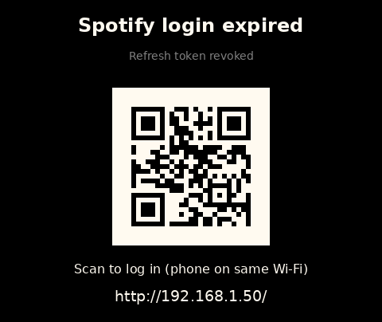
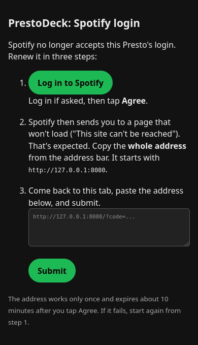

> Originally based on [fatihak/PrestoDeck](https://github.com/fatihak/PrestoDeck).

Icons by [Icons8](https://icons8.com)

# PrestoDeck

PrestoDeck is a Spotify music controller for the [Pimoroni Presto](https://collabs.shop/xbvgb2). It displays album cover art and the currently playing track, with touch controls for playback.

**Contents**
1. [First-time setup](#1-first-time-setup)
2. [Usage](#2-usage)
3. [Maintenance](#3-maintenance)
4. [Technical details](#4-technical-details)

---

## 1. First-time setup

You need:
- A [Pimoroni Presto](https://collabs.shop/xbvgb2) and a USB-C cable
- A computer
- A Spotify account
- A Wi-Fi network with internet access

### Step 1: Install Thonny
Download and install [Thonny](https://thonny.org/). You'll use it to copy files to the Presto.

### Step 2: Download PrestoDeck
```bash
git clone https://github.com/github-0/PrestoDeck.git
```
(Or download the repository as a ZIP from GitHub and unzip it.)

### Step 3: Create a Spotify app
1. Go to [Spotify for Developers](https://developer.spotify.com/dashboard/applications) and sign in.
2. Click **Create an App** and give it any name and description.
3. Set the Redirect URI to `http://127.0.0.1:8080`
4. Tick the **Web API** box and save.
5. Open the app's settings and note its **Client ID** and **Client Secret**.

### Step 4: Add your Wi-Fi and Spotify app details
1. In the downloaded `src` folder, rename `secrets_template.py` to `secrets.py`.
2. Open it in Thonny (or any text editor) and fill in your own data.
3. Save the file.

### Step 5: Copy the files to the Presto
1. Connect the Presto to your computer with the USB-C cable.
2. In Thonny, set the interpreter to **MicroPython (Raspberry Pi Pico)**.
3. In Thonny's Files panel, open the `src` folder, select everything in it, right-click and choose **Upload to /**.

### Step 6: Start it and log in to Spotify
1. Open `main.py` in Thonny and click **Run** (or unplug the Presto from the computer and power it from any USB charger; it starts by itself).
2. The Presto shows **Connect to Spotify** with a QR code and a web address. Follow [Logging in to Spotify](#logging-in-to-spotify).

Done. Start playing something on Spotify on any device and it appears on the Presto.

---

## 2. Usage

The Presto shows the album cover of whatever is playing on your Spotify account, on any device.

### Touch controls
The whole screen is a touch area; there are no visible buttons.

| Tap | Does |
|---|---|
| Left half | Previous track |
| Right half | Next track |
| Bottom strip (lowest 20 %) | Play / pause |

### What you'll see
- **Track name and artist** appear for 5 seconds whenever the track changes.
- **The LEDs** on the back glow in colours matching the album cover. With very dark covers they switch to a dim warm glow instead of going off.
- **A message bar at the top** appears if something is wrong. It goes away by itself once the problem is fixed.
- **A QR code and a web address** mean the Spotify login needs to be renewed. See [Maintenance](#3-maintenance).

The display's text rendering can only support basic Latin letters (A–Z), so track and artist names are simplified:
- Common accented letters lose their accents (ä → a, é → e, ñ → n, ß → ss, ...).
- Anything else (Japanese, Cyrillic, emoji, and less common accented letters such as č or ł) is shown as a space, so a name written entirely in another alphabet appears blank.

---

## 3. Maintenance

PrestoDeck runs on its own, but a few things need attention now and then.

### Renewing the Spotify login
Spotify's login on the Presto expires after 180 days (as of 10/2026). When that happens the Presto shows **Spotify login expired** with a QR code and a web address. Follow instructions on the web page.

| Presto screen | Login page |
|---|---|
|  |  |

#### Alternative: log in from a PC
If logging in through the Presto's page doesn't work, run this on a computer with Python 3:
```bash
bash adhoc/generate_token.sh
```
Enter your Client ID, Client Secret and Redirect URI when asked, and log in to Spotify in the browser that opens. Then replace the `SPOTIFY_CREDENTIALS` line in `secrets.py` on the Presto with the line the script prints.

### Other things that can break it
- **Wi-Fi name or password changed** — update `WIFI_SSID` / `WIFI_PASSWORD` in `secrets.py`.
- **Spotify app disabled or deleted** — the Presto shows what to check in `secrets.py`. Make sure the app still exists in the [Spotify developer dashboard](https://developer.spotify.com/dashboard) and that the Client ID and Secret match.
- **Album art stops loading permanently** — the free image service wsrv.nl may be down or gone. See [Online dependencies](#online-dependencies).

### Updating PrestoDeck
Download the new version and upload the contents of `src` again as in [Step 5](#step-5-copy-the-files-to-the-presto). 

---

## 4. Technical details

### Online dependencies

The Presto connects to these services:

| Service | Used for |
|---|---|
| `api.spotify.com` | Reading what's playing (every 10 s, `SPOTIFY_POLL_INTERVAL`) and the playback buttons |
| `accounts.spotify.com` | Getting a new access token at startup and about once an hour. Also used once to trade a login for a refresh token. |
| `wsrv.nl` (free third-party image proxy, also known as images.weserv.nl) | Album art: it downloads the cover from Spotify's image CDN and resizes it to 480×480. Also returns the 1×1 sample of the cover used for the minimum LED brightness. |

Every request gives up after 10 s (Spotify) or 15 s (album art, `IMAGE_TIMEOUT`), so a stalled connection can't freeze the screen. If Wi-Fi drops, the Presto tries to reconnect every 30 s (`WIFI_RETRY_INTERVAL`).

wsrv.nl receives the Spotify image URL of every track you play, but no Spotify login or account data. The Presto never contacts Spotify's image CDN directly.

**Setup only:**
- [Spotify for Developers](https://developer.spotify.com/dashboard) to create the app and its Client ID/Secret. Spotify must keep the app enabled.
- The `aiohttp` MicroPython package, if your firmware doesn't include it: `mpremote mip install aiohttp` (downloads it from micropython-lib).

### How the LED colours work

- **Ambient colours are computed on the Presto.** The firmware's `auto_ambient_leds` derives the LED colours from what's on screen. No online service is involved.
- **The minimum brightness check uses wsrv.nl.** On each track change the Presto fetches a 1×1 PNG of the cover from wsrv.nl and computes its perceived brightness. Below `LED_DARK_THRESHOLD` it turns off the ambient mode and sets all LEDs to the fixed `LED_MIN_COLOR`; otherwise it uses the ambient colours.
- If only the sample fetch fails, the check is skipped and the LEDs stay in whichever mode the previous track set. If the cover itself fails, the LEDs switch to `LED_MIN_COLOR`.

Settings in `src/applications/spotify/spotify.py`:

| Setting | Default | Effect |
|---|---|---|
| `LED_BRIGHTNESS_ENABLED` | `True` | `False` disables the minimum brightness and removes the extra request. Ambient colours keep working. |
| `LED_DARK_THRESHOLD` | `60` | Brightness (0–255) below which the fixed colour is used. Raise to trigger more often. |
| `LED_MIN_COLOR` | `(50, 30, 10)` | RGB colour of all 7 LEDs for dark covers. |

### Spotify tokens

The app uses three kinds of Spotify tokens:

| Token | Lifetime | Where it lives | Purpose |
|---|---|---|---|
| Authorization code | ~10 minutes, single use | The address you copy during login. Not stored. | Exchanged once for a refresh token. |
| Refresh token | 180 days (as of 10/2026) | `spotify_token.json` (login through the Presto's page, or when Spotify rotates the token) or `secrets.py` (PC script). A newly pasted token in `secrets.py` wins; otherwise the saved file does. | Used to get access tokens. When it's rejected, the Presto shows the re-login screen. |
| Access token | 1 hour | Presto memory only | Sent with every Spotify API request (`Authorization: Bearer ...`). Renewed automatically. |

The login page uses the `redirect_uri` from `SPOTIFY_CREDENTIALS`, or `http://127.0.0.1:8080` if there isn't one. It must exactly match a Redirect URI set for your app in the Spotify developer dashboard.

---

## Additional resources

- [Pimoroni Presto GitHub](https://github.com/pimoroni/presto)
- [Getting started with Pimoroni Presto](https://learn.pimoroni.com/article/getting-started-with-presto)
- [MicroPython Spotify Web API](https://github.com/tltx/micropython-spotify-web-api)
